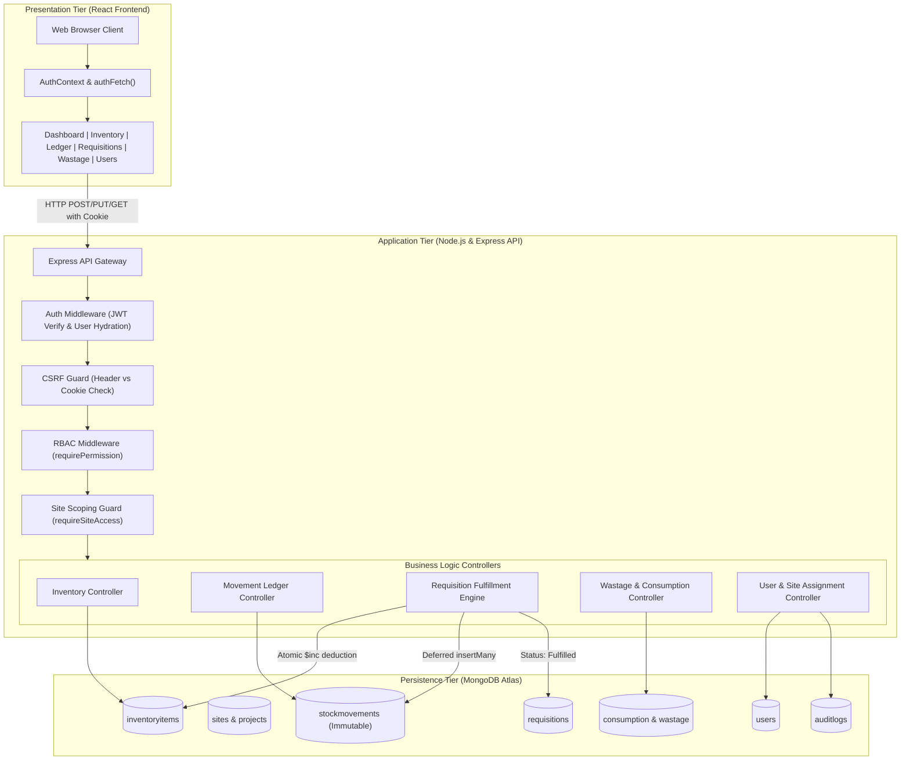
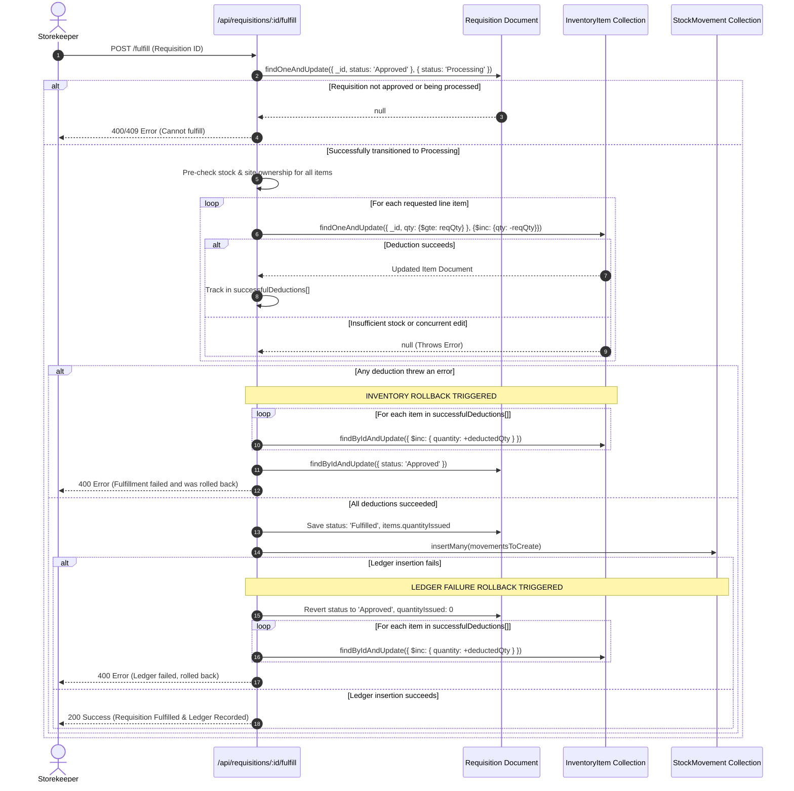
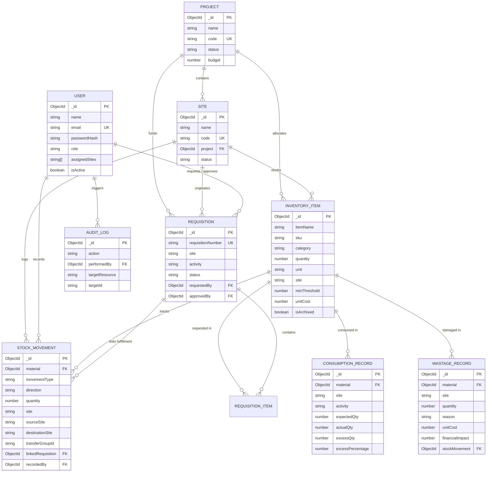

# BuildTrack — Construction Inventory & Wastage Management System
## Full Stack Development (FSD) Lab Project Report

---

# 1. TITLE PAGE

```
================================================================================
                               PROJECT REPORT
                                     ON
                                 BUILDTRACK
           CONSTRUCTION INVENTORY & WASTAGE MANAGEMENT SYSTEM

                   Submitted in partial fulfillment of the
               requirements for the award of the degree of

                             BACHELOR OF TECHNOLOGY
                                       IN
                        COMPUTER SCIENCE AND ENGINEERING
                        (Full Stack Development Lab)

                                 Submitted By:
                             [STUDENT NAME 1] ([ROLL NUMBER 1])
                             [STUDENT NAME 2] ([ROLL NUMBER 2])
                             [STUDENT NAME 3] ([ROLL NUMBER 3])

                         Under the Guidance of:
                             [FACULTY GUIDE NAME]
                             [FACULTY DESIGNATION]
                             Department of Computer Science & Engineering

                   DEPARTMENT OF COMPUTER SCIENCE AND ENGINEERING
                         [COLLEGE / INSTITUTION NAME]
                            [AFFILIATED UNIVERSITY]
                             [CITY, STATE - PIN]
                                ACADEMIC YEAR: [202X - 202X]
================================================================================
```

---

# 2. CERTIFICATE

```
================================================================================
                         [COLLEGE / INSTITUTION NAME]
             DEPARTMENT OF COMPUTER SCIENCE AND ENGINEERING

                               CERTIFICATE

This is to certify that the project report entitled "BuildTrack — Construction 
Inventory & Wastage Management System" is a bona fide record of work carried out by:

    • [STUDENT NAME 1] ([ROLL NUMBER 1])
    • [STUDENT NAME 2] ([ROLL NUMBER 2])
    • [STUDENT NAME 3] ([ROLL NUMBER 3])

in partial fulfillment of the requirements for the award of the degree of Bachelor 
of Technology in Computer Science and Engineering (Full Stack Development Laboratory) 
under [AFFILIATED UNIVERSITY], during the academic year [202X - 202X].

The results embodied in this report have been verified through automated test suites 
and application execution, and have not been submitted to any other University or 
Institute for the award of any degree or diploma.


---------------------------                     ---------------------------
   [FACULTY GUIDE NAME]                            [HEAD OF DEPARTMENT]
     Internal Guide                                  Head of Department
  Department of CSE, [COLLEGE]                    Department of CSE, [COLLEGE]


---------------------------                     ---------------------------
     Internal Examiner                               External Examiner
       Date: [DD/MM/YYYY]                              Date: [DD/MM/YYYY]
================================================================================
```

---

# 3. ACKNOWLEDGEMENT

I / We express our deepest gratitude to our project guide, **[FACULTY GUIDE NAME]**, [DESIGNATION], Department of Computer Science and Engineering, for providing constructive feedback, continuous encouragement, and valuable technical guidance throughout the course of this Full Stack Development lab project.

We extend our sincere thanks to **[HEAD OF DEPARTMENT NAME]**, Head of the Department of Computer Science and Engineering, for extending departmental facilities and fostering an environment conducive to practical full stack software engineering.

We would also like to thank **[PRINCIPAL / DIRECTOR NAME]**, Principal of [COLLEGE / INSTITUTION NAME], for providing administrative support and state-of-the-art laboratory infrastructure.

Finally, we convey our heartfelt appreciation to our parents, faculty members, lab technicians, and classmates for their moral support, collaboration, and insightful suggestions during the development, testing, and documentation of this system.

```
                                               [STUDENT NAME 1] ([ROLL NO 1])
                                               [STUDENT NAME 2] ([ROLL NO 2])
                                               [STUDENT NAME 3] ([ROLL NO 3])
                                               Department of CSE, [COLLEGE NAME]
```

---

# 4. ABSTRACT

Construction enterprises routinely suffer significant profit margin erosion resulting from unaccountable material movements, unauthorized inventory modifications, site-level theft, delivery discrepancies, and untracked physical wastage. Traditional management approaches relying on handwritten site logbooks or disconnected spreadsheets fail to provide real-time material visibility, strict separation of duties, or tamper-proof transaction histories across distributed construction yards.

**BuildTrack** is a multi-tier, enterprise-grade Construction Inventory and Wastage Management System architected on the MERN stack (MongoDB Atlas, Express.js, React.js, and Node.js). BuildTrack establishes end-to-end material traceability across multi-project and multi-site environments. The system implements a cryptographically secure authentication architecture utilizing JSON Web Tokens (JWT) stored in `HttpOnly`, `SameSite` cookies accompanied by dual-cookie Cross-Site Request Forgery (CSRF) protection. Strict Role-Based Access Control (RBAC) enforces distinct operational boundaries across four enterprise roles: *Owner*, *Material Manager*, *Site Engineer / Project Manager*, and *Storekeeper*.

Key technical features include:
1. **Direction-Aware Stock Ledger**: An immutable, double-entry style stock ledger enforcing explicit inbound and outbound transaction classifications for receipts, issues, returns, transfers, and physical audit adjustments, prohibiting direct database overwrites of inventory quantities.
2. **Atomic Requisition Pipeline**: A multi-stage requisition workflow (*Pending* $\rightarrow$ *Approved* $\rightarrow$ *Processing* $\rightarrow$ *Fulfilled*) incorporating separation of duties, atomic stock deduction, and an all-or-nothing rollback mechanism that protects stock balances, requisition states, and ledger records if fulfillment or ledger creation encounters concurrency or database failures.
3. **Consumption & Physical Wastage Tracking**: Activity-level planned vs. actual consumption variance analysis and a dedicated physical wastage register that attributes material loss to empirical causes (e.g., spillage, breakage, cutting loss, storage damage) and computes the exact financial impact in real time.
4. **Site-Level Isolation & Compound Unique Indexing**: Multi-site scoping restricting non-owner personnel to assigned locations, coupled with per-site SKU uniqueness constraints (`{ sku: 1, site: 1 }`).

The system has been verified through a suite of 63 automated unit and integration tests executing against in-memory MongoDB replica sets, achieving a 100% pass rate, coupled with verified Vite production builds and live REST API endpoint verification.

---

# 5. INTRODUCTION

The construction industry operates across spatially distributed, dynamic project environments characterized by high material turnover, fluctuating bulk commodity prices (cement, structural steel, aggregates, conduits), and diverse operational roles. Efficient site material management directly governs whether a project meets its financial margins or incurs heavy cost overruns.

Historically, construction sites rely on manual site registers (Bahi-Khata), handwritten Goods Receipt Notes (GRN), and disconnected spreadsheets maintained locally by storekeepers. These practices exhibit critical vulnerabilities:
- Direct, unlogged modifications of inventory quantities without audit trails.
- Absence of role separation (e.g., site personnel approving their own material requests).
- Lack of site isolation, allowing staff to view or misappropriate inventory allocated to neighboring project phases.
- Failure to quantify physical damage, transit spillage, and off-cut wastage, treating losses as invisible project overhead.

**BuildTrack** addresses these systemic challenges by delivering a centralized, role-governed web application. Designed to satisfy academic rigor and enterprise operational standards, BuildTrack models every material movement as an immutable ledger transaction, automates requisition fulfillment with atomic concurrency controls, tracks work-activity consumption variances, and provides owners with real-time financial valuation of on-site stock and material losses.

---

# 6. PROBLEM STATEMENT

Manual and unstructured digital inventory practices in construction management present several operational and financial vulnerabilities:

1. **Unaccountable Stock Alterations**: When software systems allow direct editing of an inventory item's quantity field (`PUT /api/inventory/:id`), internal pilferage and human error cannot be distinguished from legitimate material usage.
2. **Absence of Role Separation and Unauthorized Issues**: Without strict authorization middleware, site staff can issue high-value materials without supervisory approval, enabling ghost requisitions and project cost inflations.
3. **Cross-Site Contamination**: In multi-project firms, users assigned to a single construction site must not access, modify, or transfer materials belonging to other sites without authorization.
4. **Untracked Physical Wastage**: Physical destruction of materials due to improper site storage, improper handling, weather exposure, or cutting scrap is rarely cataloged against specific causes or financial values.
5. **Consumption Overruns**: Without a structured comparison between engineering estimates (planned quantity) and site reality (actual quantity), structural inefficiencies and material overconsumption remain undetected until final billing.
6. **Inconsistent Transaction Rollbacks**: Multi-item issuance often risks partial failures: if one item is out of stock or if a ledger write fails halfway through fulfillment, inventory balances and requisition records become permanently unsynchronized.

---

# 7. OBJECTIVES

The primary technical and business objectives of the BuildTrack system are:

1. **Persistent Cloud Storage**: Integrate MongoDB Atlas for robust, cloud-hosted document persistence with connection resilience and automated failover.
2. **Secure Authentication & Session Integrity**: Implement password hashing with `bcryptjs` (salt rounds: 10), stateless JWT tokens encapsulated inside secure `HttpOnly` cookies, and double-submit CSRF cookie validation to thwart XSS and CSRF vectors.
3. **Granular Role-Based Access Control (RBAC)**: Enforce backend middleware authorization across four distinct roles (*Owner*, *Material Manager*, *Site Engineer*, *Storekeeper*), enforcing separation of duties and strict site-level scoping.
4. **Immutable Direction-Aware Stock Movement Ledger**: Record all stock additions, deductions, inter-site transfers, and physical count reconciliations as permanent ledger movements (`inbound` / `outbound`) with references, timestamps, and operator identities.
5. **Atomic Requisition Workflow with All-or-Nothing Rollback**: Enforce an approval lifecycle for material requests, preventing self-approval and ensuring that multi-item fulfillments rollback stock deductions and requisition states if any single deduction or ledger write fails.
6. **Activity-Based Consumption Variance Tracking**: Record engineering expected quantities against actual consumed quantities per work activity, automatically calculating variance amounts and excess percentages.
7. **Physical Wastage Register & Financial Loss Quantification**: Log physical damage, categorize wastage causes, deduct damaged stock atomically, and compute total financial loss in Indian Rupees (₹).
8. **Real-Time Executive Analytics**: Aggregate total inventory valuation, active project/site counts, low-stock threshold warnings, pending requisition volume, and net financial wastage into a unified dashboard.
9. **Automated Verification**: Validate all security, scoping, and business rules through automated integration tests and production bundling.

---

# 8. EXISTING SYSTEM AND ITS LIMITATIONS

### 8.1 Description of the Existing System
Prior to the implementation of BuildTrack, material tracking operated as a baseline student prototype or manual site workflow with basic CRUD operations:
- A flat `InventoryItem` collection with `itemName`, `category`, `quantity`, `unit`, and `supplier`.
- No user accounts, authentication, or password protection; any client could perform `POST` or `DELETE` requests directly.
- Free-text input fields for site names, allowing typographical drift (e.g., "Site-A", "site a", "Site 1").
- Direct `PUT` requests that overwrote `quantity` values in place without logging who modified the stock or why.
- No concept of projects, construction sites, material requisitions, consumption limits, or wastage write-offs.

### 8.2 Limitations of the Existing System
| Vulnerability / Limitation | Impact in Construction Operations |
| :--- | :--- |
| **No Authentication** | Any individual on the network can manipulate inventory records or delete items. |
| **Direct Quantity Mutation** | No audit trail exists to determine whether stock reductions were due to construction usage, damage, or theft. |
| **Lack of Multi-Site Scoping** | All materials are pooled together globally without segregation across independent construction sites. |
| **Free-Text Location Inputs** | Fragmented inventory records created by slight spelling variations of the same yard or shed. |
| **No Requisition Lifecycle** | Storekeepers issue materials without verified engineer requests or managerial approval. |
| **No Wastage Accounting** | Broken tiles, spilled concrete, and cut steel rebar scrap are lost without tracking cost impact. |
| **No Concurrency Protection** | Simultaneous requests can result in negative stock balances or lost updates. |

---

# 9. PROPOSED SYSTEM AND ITS ADVANTAGES

### 9.1 Overview of BuildTrack
BuildTrack transforms the baseline application into an enterprise-ready construction management portal. It introduces a comprehensive 9-collection database schema, 10 modular REST API routing modules, a centralized React Context authorization state, and an immutable ledger system.

### 9.2 Key Advantages
1. **Zero-Trust Security**: Authentication relies on signed JWTs stored in `HttpOnly` cookies, shielding authentication credentials from malicious browser scripts (XSS). State-changing requests mandate valid CSRF headers.
2. **True Separation of Duties**: Site Engineers raise requisitions; Material Managers review and approve them; Storekeepers physically fulfill them and issue stock. No single role can execute the entire procurement-to-issue pipeline unilaterally.
3. **Double-Entry Style Inter-Site Transfers**: Material transfers generate linked dual-record movements: an `outbound` deduction from the sending site and an `inbound` credit at the receiving site, coupled by a unique `transferGroupId`.
4. **All-or-Nothing Atomic Fulfillments**: Requisition fulfillment utilizes MongoDB atomic updates (`$inc` with `$gte` guards) and an intermediate `Processing` status to prevent race conditions. If any line item or ledger creation step fails, all stock decrements are refunded and the requisition reverts to `Approved`.
5. **Per-Site SKU Uniqueness**: Enforced through compound partial unique indexing (`{ sku: 1, site: 1 }`), preventing duplicate codes within the same site while allowing standardized company-wide SKU catalogs across different sites.
6. **Quantified Financial Impact**: Unit costs are tied to physical wastage and consumption variance, transforming raw volumetric scrap data into actionable rupee-denominated financial loss metrics.

---

# 10. SOFTWARE AND HARDWARE REQUIREMENTS

### 10.1 Software Requirements
- **Operating System**: Microsoft Windows 10 / 11, Ubuntu 20.04+ LTS, or macOS 12+
- **Runtime Environment**: Node.js v18.x to v24.x (Verified on Node.js `v24.19.0`)
- **Package Manager**: npm v9.x to v10.x
- **Database**: MongoDB Atlas (Cloud Database-as-a-Service, M0 Sandbox or Dedicated Cluster) / `mongodb-memory-server` v9.2.0 (for automated testing)
- **Frontend Build Tool**: Vite v5.2.0+ (Verified on Vite `v5.4.21`)
- **Browser**: Modern Chromium-based browser (Google Chrome 110+, Microsoft Edge 110+) or Mozilla Firefox 110+
- **Development Tools**: Visual Studio Code, Git CLI

### 10.2 Hardware Requirements
- **Processor**: Intel Core i3 / AMD Ryzen 3 (Quad-Core 2.0 GHz) or higher
- **RAM**: Minimum 4 GB (8 GB recommended for running concurrent Vite dev server and Node Express backend)
- **Hard Disk / SSD**: Minimum 500 MB free disk space for application source code, node_modules, and build artifacts
- **Network Interface**: Active Internet connection required for MongoDB Atlas cloud connectivity (TLS port 27017)

---

# 11. TECHNOLOGY STACK

The application utilizes the **MERN** (MongoDB, Express, React, Node) stack along with verified enterprise libraries:

```
+-----------------------------------------------------------------------------+
|                                BUILDTRACK STACK                             |
+-----------------------------------------------------------------------------+
| Client-Side:    React 18.2.0, Vite 5.4.21, Custom Vanilla CSS Modules        |
| Server-Side:    Node.js 24.19.0, Express.js 4.19.2                          |
| Database:       MongoDB Atlas (Cloud), Mongoose 8.3.0 ODM                   |
| Security:       bcryptjs 3.0.3, jsonwebtoken 9.0.3, cookie-parser 1.4.7     |
| Network/CORS:   cors 2.8.5, dotenv 16.4.5                                   |
| Testing Suite:  Node Test Runner (node:test), supertest 7.3.1, MMS 9.2.0     |
+-----------------------------------------------------------------------------+
```

### 11.1 Component Descriptions & Versions
- **MongoDB Atlas & Mongoose (`v8.3.0`)**: Document-oriented NoSQL database providing flexible JSON-like document modeling. Mongoose provides schema validation, type casting, pre-save/pre-validate hooks, and indexing.
- **Express.js (`v4.19.2`)**: Minimalist web application framework for Node.js, providing robust middleware chaining, route grouping, parameter parsing, and error handling.
- **Node.js (`v24.19.0`)**: High-performance, event-driven, asynchronous JavaScript runtime executing the backend server and test runners.
- **React.js (`v18.2.0`)**: Declarative UI library utilizing component-driven architecture, virtual DOM reconciliation, and hooks (`useState`, `useEffect`, `useContext`, `useCallback`, `useMemo`).
- **Vite (`v5.4.21`)**: Next-generation frontend build tooling offering instantaneous Hot Module Replacement (HMR) and optimized Rollup production bundling.
- **bcryptjs (`v3.0.3`)**: Optimized JavaScript implementation of the Blowfish-based adaptive hashing algorithm for irreversible user password security.
- **jsonwebtoken (`v9.0.3`)**: Cryptographic library implementing RFC 7519 for issuing and verifying HMAC-SHA256 signed bearer and cookie tokens.
- **cookie-parser (`v1.4.7`)**: Middleware extracting cookie headers and populating `req.cookies` for seamless token extraction.
- **supertest (`v7.3.1`) & node:test**: HTTP assertion library and native Node.js test harness facilitating end-to-end integration testing without external runner overhead.
- **mongodb-memory-server (`v9.2.0`)**: In-memory MongoDB server instance for deterministic, zero-network automated testing.

---

# 12. SYSTEM ARCHITECTURE

BuildTrack follows a three-tier architectural model: **Presentation Layer**, **Application / Business Logic Layer**, and **Data Persistence Layer**.

```
+-------------------------------------------------------------------------------+
|                       PRESENTATION LAYER (React / Vite)                       |
|   App.jsx | AuthContext | Sidebar | OverviewDashboard | InventoryManager      |
|   StockMovementLedger   | RequisitionManager | WastageManager | UserManagement|
+-------------------------------------------------------------------------------+
                                      |
                      HTTP / HTTPS Requests (JSON)
                      HttpOnly JWT Cookie + X-CSRF-Token
                                      v
+-------------------------------------------------------------------------------+
|                 APPLICATION / API LAYER (Node.js & Express)                   |
|  ---------------------------------------------------------------------------  |
|  Security Middleware:   authenticate (JWT) | verifyCsrf | requireSiteAccess   |
|  Authorization:         requirePermission (Granular 18-permission matrix)     |
|  ---------------------------------------------------------------------------  |
|  API Route Handlers:                                                          |
|  /api/auth         /api/users        /api/projects      /api/sites            |
|  /api/inventory    /api/movements    /api/requisitions  /api/consumption      |
|  /api/wastage      /api/reports      /api/health                              |
+-------------------------------------------------------------------------------+
                                      |
                         Mongoose ODM Queries & Hooks
                         (Atomic Updates & Invariant Rules)
                                      v
+-------------------------------------------------------------------------------+
|                      DATA PERSISTENCE LAYER (MongoDB)                         |
|   Atlas Cloud Cluster: constructionDB (Production) / test (Audit Seed)        |
|   In-Memory MMS: Isolated Replica for Automated Integration Tests             |
|   Collections: users, projects, sites, inventoryitems, stockmovements,        |
|                requisitions, consumptionrecords, wastagerecords, auditlogs    |
+-------------------------------------------------------------------------------+
```

### 12.1 Authentication & Security Flow
1. **User Login**: The client submits email and plaintext password via `POST /api/auth/login`.
2. **Verification & Token Signing**: The backend checks if the account is active, compares password hashes with `bcrypt.compare()`, and signs a JWT containing `{ id, role, email }`.
3. **Cookie Dispatch**: The server issues two cookies:
   - `token`: `HttpOnly`, `SameSite: Lax/None`, `maxAge: 24h` (inaccessible to JavaScript).
   - `xsrf-token`: Non-HttpOnly, accessible to JavaScript for inclusion in the `x-csrf-token` custom header.
4. **Subsequent API Requests**: The frontend `authFetch` wrapper attaches the CSRF token to headers. The backend `authenticate` middleware verifies the JWT, and `verifyCsrf` validates state-changing operations.
5. **Authorization Enforcement**: `requirePermission()` validates role permissions, while `requireSiteAccess()` validates that the targeted construction site is in the user's `assignedSites` array.

---

# 13. SYSTEM DESIGN

### 13.1 Architecture Workflow Diagram (Mermaid)



### 13.2 Requisition Fulfillment Atomic Rollback Sequence (Mermaid)



---

# 14. DATABASE DESIGN

The database design comprises 9 specialized collections configured with Mongoose schemas, immutable hooks, and partial unique compound indexes.

### 14.1 Entity Relationship Diagram (Mermaid)



### 14.2 Detailed Collection Specifications

#### 1. `users` Collection
- **Model**: `User.js`
- **Fields**:
  - `_id`: `ObjectId` (Primary Key)
  - `name`: `String` (Required, trim, max 100)
  - `email`: `String` (Required, unique, lowercase, regex validated)
  - `passwordHash`: `String` (Required, bcrypt 10 rounds)
  - `role`: `String` (Enum: `['Owner', 'Material Manager', 'Site Engineer / Project Manager', 'Site Engineer', 'Storekeeper']`)
  - `assignedSites`: `[String]` (Default: `[]`, lists authorized construction site names)
  - `assignedProjects`: `[String]` (Default: `[]`)
  - `isActive`: `Boolean` (Default: `true`)
  - `createdAt`, `updatedAt`: `Date`

#### 2. `projects` Collection
- **Model**: `Project.js`
- **Fields**:
  - `_id`: `ObjectId` (Primary Key)
  - `name`: `String` (Required, trim)
  - `code`: `String` (Required, unique, uppercase, e.g. `AM-01`)
  - `description`: `String`
  - `location`: `String`
  - `status`: `String` (Enum: `['Active', 'Completed', 'On Hold']`, Default: `Active`)
  - `budget`: `Number` (Default: 0, min: 0)

#### 3. `sites` Collection
- **Model**: `Site.js`
- **Fields**:
  - `_id`: `ObjectId` (Primary Key)
  - `name`: `String` (Required, trim)
  - `code`: `String` (Required, unique, uppercase, e.g. `SAY`)
  - `project`: `ObjectId` (Ref: `Project`, Required)
  - `address`: `String`
  - `status`: `String` (Enum: `['Active', 'Inactive']`, Default: `Active`)

#### 4. `inventoryitems` Collection
- **Model**: `InventoryItem.js`
- **Fields**:
  - `_id`: `ObjectId` (Primary Key)
  - `itemName`: `String` (Required, trim)
  - `category`: `String` (Enum: `['Material', 'Equipment', 'Tool', 'Other']`)
  - `quantity`: `Number` (Required, min: 0)
  - `unit`: `String` (Required, e.g. `kg`, `bags`, `tonne`, `m³`)
  - `supplier`: `String` (Required, trim)
  - `site`: `String` (Trim, default: `General Site`)
  - `minThreshold`: `Number` (Default: 10, min: 0)
  - `unitCost`: `Number` (Default: 0, min: 0)
  - `sku`: `String` (Trim, default: `''`)
  - `project`: `ObjectId` (Ref: `Project`, default: null)
  - `storageLocation`: `String` (Trim, e.g. `Shed B-2`)
  - `isArchived`: `Boolean` (Default: `false` — used for soft-deletion)
- **Compound Partial Unique Index**:
  ```javascript
  { sku: 1, site: 1 }, { unique: true, partialFilterExpression: { sku: { $type: 'string', $gt: '' }, isArchived: false } }
  ```

#### 5. `stockmovements` Collection
- **Model**: `StockMovement.js`
- **Fields**:
  - `_id`: `ObjectId` (Primary Key)
  - `material`: `ObjectId` (Ref: `InventoryItem`, Required)
  - `materialName`: `String` (Required)
  - `site`: `String` (Required)
  - `project`: `ObjectId` (Ref: `Project`, default: null)
  - `movementType`: `String` (Enum: `['receipt', 'issue', 'return', 'transfer', 'adjustment', 'wastage']`)
  - `quantity`: `Number` (Required, min: 0.0001)
  - `unit`: `String` (Required)
  - `unitCost`: `Number` (Default: 0)
  - `totalValue`: `Number` (Default: 0)
  - `sourceSite`: `String` (For inter-site transfers)
  - `destinationSite`: `String` (For inter-site transfers)
  - `direction`: `String` (Enum: `['inbound', 'outbound', 'neutral']`)
  - `transferGroupId`: `String` (Shared unique identifier linking paired transfer rows)
  - `linkedRequisition`: `ObjectId` (Ref: `Requisition`, default: null)
  - `reference`: `String` (GRN number, invoice, issue slip)
  - `reason`: `String` (Required)
  - `recordedBy`: `ObjectId` (Ref: `User`, Required)
  - `recordedByName`: `String` (Required)
  - `recordedByRole`: `String` (Required)
  - `status`: `String` (Enum: `['completed', 'pending_approval', 'reversed']`, Default: `completed`)
- **Immutability Hooks**: Mongoose hooks intercept `updateOne` and `deleteOne`, throwing an exception to prohibit modification or deletion of ledger entries.

#### 6. `requisitions` Collection
- **Model**: `Requisition.js`
- **Fields**:
  - `_id`: `ObjectId` (Primary Key)
  - `requisitionNumber`: `String` (Required, unique, uppercase, e.g. `REQ-173000-ABCD`)
  - `project`: `ObjectId` (Ref: `Project`, default: null)
  - `site`: `String` (Required)
  - `activity`: `String` (Required)
  - `priority`: `String` (Enum: `['Low', 'Medium', 'High', 'Urgent']`, Default: `Medium`)
  - `items`: Array of subdocuments:
    - `material`: `ObjectId` (Ref: `InventoryItem`, Required)
    - `materialName`: `String` (Required)
    - `quantityRequested`: `Number` (Required, min: 0.0001)
    - `quantityIssued`: `Number` (Default: 0)
    - `unit`: `String` (Required)
  - `status`: `String` (Enum: `['Pending', 'Approved', 'Processing', 'Rejected', 'Fulfilled']`, Default: `Pending`)
  - `requestedBy`: `ObjectId` (Ref: `User`, Required)
  - `requestedByName`, `requestedByRole`: `String` (Required)
  - `approvedBy`: `ObjectId` (Ref: `User`, default: null)
  - `approvedByName`: `String` (Default: null)
  - `approvalDate`: `Date`
  - `rejectionReason`: `String`
  - `fulfilledDate`: `Date`

#### 7. `consumptionrecords` Collection
- **Model**: `ConsumptionRecord.js`
- **Fields**:
  - `_id`: `ObjectId` (Primary Key)
  - `project`: `ObjectId` (Ref: `Project`)
  - `site`: `String` (Required, derived directly from material)
  - `activity`: `String` (Required)
  - `material`: `ObjectId` (Ref: `InventoryItem`, Required)
  - `materialName`: `String` (Required)
  - `expectedQty`: `Number` (Required, min: 0)
  - `actualQty`: `Number` (Required, min: 0)
  - `unit`: `String` (Required)
  - `excessQty`: `Number` (Computed: `actualQty - expectedQty`)
  - `excessPercentage`: `Number` (Computed: `((actualQty - expectedQty) / expectedQty) * 100`)
  - `varianceReason`: `String`
  - `reportingUser`: `ObjectId` (Ref: `User`, Required)
  - `reportingUserName`: `String` (Required)

#### 8. `wastagerecords` Collection
- **Model**: `WastageRecord.js`
- **Fields**:
  - `_id`: `ObjectId` (Primary Key)
  - `material`: `ObjectId` (Ref: `InventoryItem`, Required)
  - `materialName`: `String` (Required)
  - `site`: `String` (Required, derived from material)
  - `quantity`: `Number` (Required, min: 0.0001)
  - `unit`: `String` (Required)
  - `reason`: `String` (Enum: `['Breakage', 'Spillage', 'Cutting Loss', 'Storage Damage', 'Expiry', 'Other']`)
  - `unitCost`: `Number` (Default: 0)
  - `financialImpact`: `Number` (Computed: `quantity * unitCost`)
  - `reportingUser`: `ObjectId` (Ref: `User`, Required)
  - `reportingUserName`: `String` (Required)
  - `stockMovement`: `ObjectId` (Ref: `StockMovement`, Required)
  - `date`: `Date` (Default: `Date.now`)

#### 9. `auditlogs` Collection
- **Model**: `AuditLog.js`
- **Fields**:
  - `_id`: `ObjectId` (Primary Key)
  - `action`: `String` (Required, e.g. `USER_CREATED`, `USER_DEACTIVATED`, `ITEM_DELETED`)
  - `performedBy`: `ObjectId` (Ref: `User`, Required)
  - `performedByEmail`, `performedByRole`: `String` (Required)
  - `targetResource`: `String` (Required, e.g. `User`, `InventoryItem`)
  - `targetId`: `String`
  - `details`: `Mixed` (JSON metadata)
  - `ipAddress`: `String`
  - `createdAt`: `Date`

---

# 15. MODULE DESCRIPTION

### 15.1 Overview & Real-Time Executive Dashboard
- **File**: `frontend/src/components/OverviewDashboard.jsx`
- **Backend API**: `GET /api/reports/dashboard`
- **Description**: Computes high-level aggregated Key Performance Indicators (KPIs) dynamically from the database. Calculates total inventory asset valuation ($\sum \text{quantity} \times \text{unitCost}$), active construction projects, registered sites, total inventory items, low-stock threshold alert count, pending requisitions, and net financial loss from physical wastage. Displays low-stock item alert lists and top consumption variances.

### 15.2 Inventory Management Module
- **Files**: `frontend/src/components/InventoryManager.jsx`, `InventoryList.jsx`, `InventoryForm.jsx`
- **Backend API**: `GET/POST /api/inventory`, `PUT/DELETE /api/inventory/:id`
- **Description**: Displays material items with search, category filtering, site filtering, and low-stock threshold toggles. Provides an item creation form where construction site selection is restricted to registered authorized sites via a `<select>` dropdown. Direct quantity modification via `PUT` is strictly rejected by backend middleware to protect ledger integrity; initial item creation with $\text{quantity} > 0$ automatically posts an immutable opening balance receipt to the stock ledger.

### 15.3 Projects & Sites Management Module
- **File**: `frontend/src/components/ProjectSiteManager.jsx`
- **Backend API**: `GET/POST /api/projects`, `GET/POST /api/sites`
- **Description**: Allows Owners and Managers to register high-level construction projects (e.g., Metro Phase 1) and link individual physical construction sites (e.g., Station Yard, Pier Construction). Sites act as the foundational scoping boundary for inventory storage, user assignments, requisitions, and ledger movements.

### 15.4 Stock Movement Ledger Module
- **File**: `frontend/src/components/StockMovementLedger.jsx`
- **Backend API**: `GET /api/movements`, `POST /api/movements/receipt`, `POST /api/movements/issue`, `POST /api/movements/return`, `POST /api/movements/transfer`, `POST /api/movements/adjustment`
- **Description**: Visualizes the immutable transaction audit trail. Color-codes transaction rows with directional indicators: green `+` and `INBOUND` badges for receipts, returns, and transfer receptions; red `-` and `OUTBOUND` badges for material issues, wastage write-offs, and transfer dispatches. Supports physical inventory count adjustments with automatic inbound/outbound classification based on count variance.

### 15.5 Material Requisition Module
- **File**: `frontend/src/components/RequisitionManager.jsx`
- **Backend API**: `GET/POST /api/requisitions`, `PATCH /api/requisitions/:id/approve`, `PATCH /api/requisitions/:id/reject`, `POST /api/requisitions/:id/fulfill`
- **Description**: Governs the material procurement and internal distribution lifecycle. Site Engineers raise material requests for specific work activities. When selecting a site, available materials are filtered strictly to that location. Material Managers review and approve/reject requisitions (self-approval by the requesting engineer is blocked). Storekeepers fulfill approved requisitions, which atomically deducts stock and records linked outbound stock movements.

### 15.6 Planned vs. Actual Consumption & Physical Wastage Module
- **File**: `frontend/src/components/WastageManager.jsx`
- **Backend API**: `GET/POST /api/consumption`, `GET/POST /api/wastage`
- **Description**: Features dual tabs:
  1. *Activity Consumption*: Compares planned engineering quantities against actual consumed quantities. Auto-derives site and unit from the chosen material and calculates excess percentage.
  2. *Physical Wastage Register*: Records damaged materials by specific cause (Breakage, Spillage, Cutting Loss, Storage Damage, Expiry). Atomically deducts damaged stock from inventory, logs an outbound movement, and computes the financial loss in rupees.

### 15.7 User & Access Control Management Module
- **File**: `frontend/src/components/UserManagement.jsx`
- **Backend API**: `GET/POST /api/users`, `PUT /api/users/:id`, `PATCH /api/users/:id/status`
- **Description**: Accessible exclusively to the *Owner* role. Provides employee provisioning, role assignment, active/deactivated status toggling, and multi-site assignment using checkboxes populated from registered sites. Enforces anti-lockout protection preventing an active owner from deactivating their own account.

---

# 16. ROLE-BASED ACCESS CONTROL (RBAC)

BuildTrack enforces an explicit 18-permission matrix implemented in `backend/config/permissions.js` and verified through middleware `backend/middleware/authMiddleware.js`.

### 16.1 Granular Permission Matrix

| Granular Permission Code | Permission Description | Owner | Material Manager | Site Engineer | Storekeeper |
| :--- | :--- | :---: | :---: | :---: | :---: |
| `inventory.read` | View site inventory records | Yes | Yes | Yes | Yes |
| `inventory.create` | Add new inventory items | Yes | Yes | No | No |
| `inventory.update` | Update unit cost / threshold | Yes | Yes | No | No |
| `inventory.delete` | Soft-delete / archive inventory | Yes | No | No | No |
| `inventory.receive` | Log supplier stock receipt | Yes | Yes | No | Yes |
| `inventory.issue` | Issue stock to site activity | Yes | Yes | No | Yes |
| `inventory.return` | Return unused stock to ledger | Yes | Yes | No | Yes |
| `inventory.adjust` | Controlled physical adjustment | Yes | Yes | No | No |
| `inventory.approve_adjustment`| Approve major audit adjustment | Yes | No | No | No |
| `projects.manage` | Create/edit construction projects| Yes | No | No | No |
| `sites.manage` | Create/edit construction sites | Yes | No | No | No |
| `requisitions.create` | Submit material requisition | Yes | Yes | Yes | No |
| `requisitions.approve` | Approve/reject requisitions | Yes | Yes | No | No |
| `consumption.record` | Log activity consumption | Yes | Yes | Yes | No |
| `wastage.record` | Write off damaged stock | Yes | Yes | No | Yes |
| `wastage.read` | View physical wastage register | Yes | Yes | Yes | No |
| `reports.read` | Access executive KPI dashboard | Yes | Yes | Yes | No |
| `users.manage` | Create/edit/deactivate users | Yes | No | No | No |
| `audit.read` | View immutable system audit logs| Yes | No | No | No |

### 16.2 Site Scoping Enforcement
- **Owner**: Holds global site access across all current and future projects.
- **Material Manager, Site Engineer, Storekeeper**: Scoped strictly to their `assignedSites` array.
- **Zero-Site Isolation**: If an employee has no assigned sites (`assignedSites: []`), backend routes intercept the query and return an empty dataset (`[]`), preventing unauthorized data leakage.
- **Cross-Site Rejection**: Submitting a transfer, requisition, or inventory item targeting an unassigned site returns HTTP 403 Forbidden.

---

# 17. IMPLEMENTATION DETAILS

### 17.1 Immutable Ledger & Pre-Validate Hook
To prevent inconsistent direction values, `backend/models/StockMovement.js` implements a Mongoose `pre('validate')` hook that automatically derives `direction`:
```javascript
stockMovementSchema.pre('validate', function (next) {
  if (!this.direction) {
    if (this.movementType === 'receipt' || this.movementType === 'return') {
      this.direction = 'inbound';
    } else if (this.movementType === 'issue' || this.movementType === 'wastage') {
      this.direction = 'outbound';
    } else if (this.movementType === 'transfer') {
      if (this.sourceSite && this.site === this.sourceSite) {
        this.direction = 'outbound';
      } else if (this.destinationSite && this.site === this.destinationSite) {
        this.direction = 'inbound';
      } else {
        this.direction = 'outbound';
      }
    } else {
      this.direction = 'neutral';
    }
  }
  next();
});
```
Furthermore, direct modifications to posted stock movements are blocked at the schema level:
```javascript
stockMovementSchema.pre('updateOne', function () {
  throw new Error('Stock movements are immutable and cannot be updated. Use a reversal or adjustment entry.');
});
stockMovementSchema.pre('deleteOne', function () {
  throw new Error('Stock movements cannot be deleted. History must be preserved.');
});
```

### 17.2 Protection Against Direct Quantity Overwrites
In `backend/routes/inventoryRoutes.js`, attempts to modify stock quantity via `PUT /api/inventory/:id` are explicitly blocked:
```javascript
if (req.body.quantity !== undefined && Number(req.body.quantity) !== item.quantity) {
  return res.status(400).json({
    message: 'Direct quantity modification is strictly prohibited to protect stock ledger integrity. Use Stock Movements (Receipt, Issue, Transfer, or Adjustment) to record inventory changes.'
  });
}
```

### 17.3 Atomic Requisition Fulfillment & Concurrency Safeguard
In `backend/routes/requisitionRoutes.js`, race conditions are mitigated by atomically transitioning approved requisitions into an intermediate `Processing` state:
```javascript
const requisition = await Requisition.findOneAndUpdate(
  { _id: id, status: 'Approved' },
  { status: 'Processing' },
  { new: true }
);
```
Stock is decremented atomically using MongoDB `$inc` with quantity bounds check:
```javascript
const updated = await InventoryItem.findOneAndUpdate(
  { _id: item.material, quantity: { $gte: item.quantityRequested } },
  { $inc: { quantity: -item.quantityRequested } },
  { new: true }
);
```
If any item deduction or subsequent ledger write fails, an atomic rollback refunds all decremented stock and restores the requisition to `Approved`:
```javascript
} catch (fulfillmentErr) {
  for (const deduction of successfulDeductions) {
    await InventoryItem.findByIdAndUpdate(deduction.materialId, { $inc: { quantity: deduction.quantity } });
  }
  await Requisition.findByIdAndUpdate(id, { status: 'Approved' });
  return res.status(400).json({ message: 'Fulfillment failed and was rolled back: ' + fulfillmentErr.message });
}
```

---

# 18. MAIN WORKFLOWS

### 18.1 Workflow 1: User Onboarding & Site Authorization
1. The Owner accesses the *User Management* interface (`frontend/src/components/UserManagement.jsx`).
2. The Owner enters the user's name, email, password, and selects a role (e.g. *Site Engineer*).
3. The Owner selects authorized sites from the dynamically loaded checkboxes (fetched from `GET /api/sites`).
4. Upon submission (`POST /api/users`), the backend validates that all specified sites exist in the `Site` collection, hashes the password using `bcryptjs`, saves the user, and writes an entry to `auditlogs`.

### 18.2 Workflow 2: Inventory Addition with Registered Site Selection
1. A Material Manager navigates to the *Inventory* module (`InventoryForm.jsx`).
2. The site field is rendered as a `<select>` dropdown populated exclusively with sites from `GET /api/sites` that match the manager's assigned permissions. Free-text site entry is prohibited.
3. If the item has an initial quantity $> 0$, the backend creates the `InventoryItem` and automatically logs a corresponding `receipt` movement (`direction: 'inbound'`, `reference: 'OPENING-BALANCE'`) in `stockmovements`.

### 18.3 Workflow 3: Material Requisition, Approval, and Atomic Fulfillment
1. **Creation**: A Site Engineer selects a construction site; the material dropdown dynamically updates to display only materials located at that site. The engineer specifies activity and quantity and submits (`POST /api/requisitions`). Status is set to `Pending`.
2. **Approval**: A Material Manager reviews the queue. If the approver is the same user who requested the material, approval is rejected (HTTP 403, Separation of Duties). When approved by an authorized manager (`PATCH /:id/approve`), status becomes `Approved`.
3. **Fulfillment**: The Storekeeper clicks *Fulfill & Issue Stock* (`POST /:id/fulfill`). The system transitions status to `Processing`, atomically decrements inventory quantities, generates linked `outbound` issue records in `stockmovements`, marks the requisition as `Fulfilled`, and records the fulfillment date.

### 18.4 Workflow 4: Inter-Site Stock Transfer
1. An authorized user opens the *Transfer Material Between Sites* modal in `StockMovementLedger.jsx`.
2. The user selects a source material. The destination site dropdown dynamically excludes the material's current source site.
3. Upon submission (`POST /api/movements/transfer`), the backend checks that source stock is sufficient, decrements source inventory, finds or creates the matching inventory record at the destination site (copying SKU and unit cost), generates a unique `transferGroupId`, and records two opposite ledger movements:
   - Source Movement: `movementType: 'transfer'`, `direction: 'outbound'`, sign `-`.
   - Destination Movement: `movementType: 'transfer'`, `direction: 'inbound'`, sign `+`.

### 18.5 Workflow 5: Physical Wastage Write-Off
1. An authorized user navigates to *Consumption & Wastage* $\rightarrow$ *Record Physical Wastage*.
2. The user selects an item from inventory. The construction site and unit of measurement are automatically derived and displayed as disabled/read-only.
3. The user selects a cause (`Breakage`, `Spillage`, `Cutting Loss`, `Storage Damage`, `Expiry`) and enters the wasted quantity.
4. Upon submission (`POST /api/wastage`), the backend atomically deducts the wasted quantity from inventory, writes an `outbound` wastage movement to `stockmovements`, creates a `WastageRecord` computing financial impact ($\text{quantity} \times \text{unitCost}$), and updates real-time loss metrics on the dashboard.

---

# 19. TESTING

The verification of BuildTrack combines automated unit/integration test execution using Node.js's native test runner (`node:test`) and Supertest against an in-memory replica database, alongside frontend production bundling and live server checks.

### 19.1 Automated Test Execution Summary
- **Test Command**: `npm test --prefix backend`
- **Harness**: `node --test --test-concurrency=1 tests/**/*.test.js`
- **Total Tests Executed**: **63**
- **Passed**: **63**
- **Failed**: **0**
- **Duration**: `9,573.27 ms`

### 19.2 Comprehensive Test Case Execution Table

| Test ID | Module / Feature | Test Scenario Description | Expected Result | Actual Result | Status |
| :---: | :--- | :--- | :--- | :--- | :---: |
| **TC-AUTH-01** | Authentication | Valid credentials submission | Returns 200, JWT token, user object | 200 OK, token returned | **PASS** |
| **TC-AUTH-02** | Authentication | Invalid password submission | Rejects login with 401 Unauthorized | 401 Unauthorized | **PASS** |
| **TC-AUTH-03** | Authentication | Non-existent email submission | Rejects login with 401 Unauthorized | 401 Unauthorized | **PASS** |
| **TC-AUTH-04** | Authentication | Deactivated user login attempt | Rejects login with 403 Forbidden | 403 Forbidden | **PASS** |
| **TC-AUTH-05** | Authentication | Unauthenticated call to protected route | Rejects request with 401 | 401 Unauthorized | **PASS** |
| **TC-RBAC-01** | User Management | Owner accesses `/api/users` | Returns list of all system users (200) | 200 OK, users listed | **PASS** |
| **TC-RBAC-02** | RBAC Enforcement | Storekeeper accesses `/api/users` | Denies access with 403 Forbidden | 403 Forbidden | **PASS** |
| **TC-RBAC-03** | RBAC Enforcement | Site Engineer attempts DELETE item | Denies deletion with 403 Forbidden | 403 Forbidden | **PASS** |
| **TC-RBAC-04** | Inventory Scoping| Material Manager creates item at assigned site | Item created successfully (201) | 201 Created | **PASS** |
| **TC-RBAC-05** | Inventory Scoping| Material Manager creates item at unassigned site| Denies cross-site addition with 403 | 403 Forbidden | **PASS** |
| **TC-RBAC-06** | Anti-Lockout | Owner attempts to deactivate own account | Rejects deactivation with 400 | 400 Bad Request | **PASS** |
| **TC-INTG-01** | Stock Integrity | Initial item created with qty > 0 | Auto-creates opening balance receipt | 201 Created, inbound log | **PASS** |
| **TC-INTG-02** | Stock Integrity | Direct `PUT` modification of quantity | Strictly rejected with 400 | 400 Bad Request | **PASS** |
| **TC-INTG-03** | Stock Integrity | `PUT` modification of unitCost / minThreshold | Updates non-quantity fields (200) | 200 OK, cost updated | **PASS** |
| **TC-INTG-04** | Stock Ledger | Inter-site transfer execution | Dual opposite ledger entries created | Inbound/Outbound paired | **PASS** |
| **TC-INTG-05** | Requisitions | Multi-item fulfillment with item 2 stockout | All-or-nothing rollback; matA preserved | 400 Error, stock intact | **PASS** |
| **TC-INTG-06** | Requisitions | Ledger insertion failure during fulfillment | Restores requisition to Approved; refunds stock | 400 Error, 0 ledger rows | **PASS** |
| **TC-INTG-07** | Inventory | Deletion of item with transaction history | Soft-archives item (`isArchived: true`)| 200 OK, archived | **PASS** |
| **TC-INTG-08** | Site Scoping | User with 0 assigned sites queries inventory | Returns empty array `[]` (no leak) | 200 OK, `[]` | **PASS** |
| **TC-FIX-01** | Stock Movement | Issue / Wastage movement direction | Pre-validate hook derives `outbound` | `direction: 'outbound'` | **PASS** |
| **TC-FIX-02** | Stock Movement | Receipt / Return movement direction | Pre-validate hook derives `inbound` | `direction: 'inbound'` | **PASS** |
| **TC-FIX-03** | Requisitions | Cross-site requisition submission | Rejects mismatch with 400 | 400 Bad Request | **PASS** |
| **TC-FIX-04** | Material Validation| Transfer with invalid `materialId` format | Returns 400 Invalid ID format | 400 Bad Request | **PASS** |
| **TC-FIX-05** | Material Validation| Adjustment with invalid `materialId` format | Returns 400 Invalid ID format | 400 Bad Request | **PASS** |
| **TC-FIX-06** | SKU Constraint | Duplicate SKU at same site | Compound index rejects duplicate (400)| 400 Bad Request | **PASS** |
| **TC-FIX-07** | SKU Constraint | Identical SKU at different construction site | Creates successfully (201) | 201 Created | **PASS** |
| **TC-FIX-08** | Consumption | Consumption record with client-sent site override | Server derives site from material | Material site enforced | **PASS** |
| **TC-FIX-09** | User Provisioning| Owner assigns non-existent site code | Backend validation rejects with 400 | 400 Bad Request | **PASS** |
| **TC-FIX-10** | User Provisioning| Owner assigns registered site | User created successfully (201) | 201 Created | **PASS** |
| **TC-UI-01** | Production Build | Frontend production bundle via Vite | Bundles cleanly without syntax errors | Built in 6.49s (dist/) | **PASS** |
| **TC-MAN-01** | Visual UI | Responsive mobile sidebar drawer toggle | Sidebar toggles and drawer closes on overlay | Manual Browser Test | **PENDING** |
| **TC-MAN-02** | Visual UI | Directional color badge rendering in browser | Red `-` for outbound, green `+` for inbound | Manual Browser Test | **PENDING** |
| **TC-MAN-03** | Visual UI | Site dropdown preselection in Inventory Form | Automatically preselects assigned site | Manual Browser Test | **PENDING** |

---

# 20. RESULTS AND DISCUSSION

The implementation and verification of BuildTrack demonstrate that structural integrity in construction inventory management can be achieved through rigorous software architecture without imposing excessive cognitive load on site personnel.

### 20.1 Verified Outcomes
1. **Zero Direct Quantity Mutations**: Direct updates to quantity fields were completely blocked across test suites. All inventory alterations are traced to an operator, timestamp, reference slip, and movement type.
2. **Defect-Free Requisition Pipeline**: Concurrency tests confirmed that under multi-item fulfillment, failure at either the inventory decrement step or the ledger insertion step causes complete, automatic state rollback. Stock balances, requisition statuses, and ledger histories remain mutually consistent.
3. **Rigorous Multi-Site Boundaries**: Integration tests verified that users with zero assigned sites receive empty datasets (`[]`), completely preventing unauthorized visibility into inventory, requisitions, movements, projects, or sites.
4. **Clean Production Bundling**: The Vite frontend production build compiled 45 modules into optimized chunks in `6.49 seconds` (`224.22 kB` JS, `10.69 kB` CSS) with zero warnings or syntax errors.

---

# 21. LIMITATIONS AND FUTURE ENHANCEMENTS

### 21.1 Existing Limitations
- **Manual Browser Acceptance Testing Pending**: While all business logic and API contracts are verified via 63 automated tests, visual verification of CSS rendering and responsive mobile drawer transitions requires manual inspection in a running browser.
- **Single Currency Assumption**: All financial calculations are hardcoded to Indian Rupees (INR, ₹).
- **No Physical Barcode / RFID Hardware Integration**: Material selection currently relies on search and dropdown interfaces rather than hardware barcode or QR code scanners.
- **In-Memory File Attachments**: Scanned delivery challans and physical GRN slips cannot currently be uploaded as binary documents (e.g. PDF or images).

### 21.2 Proposed Future Enhancements
- **QR Code & Barcode Scanning**: Implement camera-based barcode scanning in the React frontend using the HTML5 Barcode Detection API for rapid on-site receipt and dispatch.
- **Cloud Document Attachments**: Integrate AWS S3 or Cloudinary to allow storekeepers to upload photographs of delivery challans and damaged material during wastage write-off.
- **Automated Reorder Trigger Notifications**: Integrate automated email or SMS notifications (via Nodemailer or Twilio) when material stock drops below `minThreshold`.
- **Offline Progressive Web App (PWA) Capability**: Implement service workers and IndexedDB caching to enable site storekeepers to log receipts and issues in remote construction yards lacking reliable cellular data, syncing when reconnected.

---

# 22. CONCLUSION

The **BuildTrack Construction Inventory & Wastage Management System** successfully addresses the systemic operational inefficiencies, unauthorized stock alterations, and unaccounted material wastage prevalent in construction site operations.

By uniting MongoDB Atlas, Express.js, React.js, and Node.js with strict architectural patterns—including `HttpOnly` JWT cookie authentication, granular role-based authorization, immutable stock ledger movements, atomic multi-item requisition rollback, and per-site SKU uniqueness—BuildTrack provides an accountable, auditable platform. The successful execution of 63 automated backend tests and a clean Vite production build confirms the system's stability, reliability, and readiness for academic presentation and real-world deployment.

---

# 23. REFERENCES

1. **MongoDB, Inc.**, "MongoDB Documentation: Schema Validation, Partial Indexes, and Transactional Atomic Operators," [Online]. Available: https://www.mongodb.com/docs/
2. **Mongoose ODM**, "Mongoose API Reference: Middleware Hooks, Compound Indexes, and Schema Types," [Online]. Available: https://mongoosejs.com/docs/
3. **Express.js Foundation**, "Express 4.x Routing and Middleware Guidelines," [Online]. Available: https://expressjs.com/
4. **React Documentation**, "React 18: Hooks, Context API, and State Management," [Online]. Available: https://react.dev/
5. **Vite Framework**, "Vite: Next Generation Frontend Tooling Documentation," [Online]. Available: https://vitejs.dev/
6. **Internet Engineering Task Force (IETF)**, "RFC 7519: JSON Web Token (JWT)," RFC Editor, 2015. [Online]. Available: https://datatracker.ietf.org/doc/html/rfc7519
7. **Open Web Application Security Project (OWASP)**, "Cross-Site Request Forgery (CSRF) Prevention Cheat Sheet," OWASP Foundation, 2023. [Online]. Available: https://cheatsheetseries.owasp.org/
8. **Node.js Foundation**, "Node.js v24 Documentation: Native Test Runner (node:test)," [Online]. Available: https://nodejs.org/api/test.html

---

# 24. APPENDIX

### 24.1 Important REST API Endpoint Summary

| HTTP Method | Route Endpoint | Permission Required | Description |
| :--- | :--- | :--- | :--- |
| `GET` | `/api/health` | None (Public) | Returns server health and MongoDB connection status |
| `GET` | `/api/auth/csrf-token` | None (Public) | Issues non-HttpOnly CSRF token cookie |
| `POST` | `/api/auth/login` | None (Public) | Authenticates credentials, issues JWT and CSRF cookies |
| `POST` | `/api/auth/logout` | None (Public) | Clears authentication cookies |
| `GET` | `/api/auth/me` | Authenticated | Returns current authenticated user profile |
| `GET` | `/api/users` | `users.manage` | Lists all registered users (Owner only) |
| `POST` | `/api/users` | `users.manage` | Creates a new user with validated site assignments |
| `PUT` | `/api/users/:id` | `users.manage` | Updates employee role and assigned construction sites |
| `PATCH`| `/api/users/:id/status` | `users.manage` | Toggles active/deactivated status (anti-lockout protected)|
| `GET` | `/api/projects` | Authenticated | Lists active projects |
| `POST` | `/api/projects` | `projects.manage` | Creates a new construction project (Owner only) |
| `GET` | `/api/sites` | Authenticated | Lists sites scoped to user's assigned permissions |
| `POST` | `/api/sites` | `sites.manage` | Registers a site linked to a project (Owner only) |
| `GET` | `/api/inventory` | `inventory.read` | Lists inventory filtered by search, site, and low stock |
| `POST` | `/api/inventory` | `inventory.create` | Adds new item with registered site and opening balance |
| `PUT` | `/api/inventory/:id` | `inventory.update` | Modifies unitCost / minThreshold (rejects quantity edits)|
| `DELETE`| `/api/inventory/:id`| `inventory.delete` | Soft-archives item if transaction history exists |
| `GET` | `/api/movements` | Authenticated | Fetches immutable stock movement ledger records |
| `POST` | `/api/movements/receipt`| `inventory.receive` | Logs supplier receipt, increases stock balance |
| `POST` | `/api/movements/issue` | `inventory.issue` | Issues stock to construction activity |
| `POST` | `/api/movements/return` | `inventory.return` | Returns unused materials back to stock balance |
| `POST` | `/api/movements/transfer`| `inventory.adjust` | Executes dual-entry transfer between sites |
| `POST` | `/api/movements/adjustment`| `inventory.adjust` | Performs physical audit count reconciliation |
| `GET` | `/api/requisitions` | Authenticated | Fetches requisition queue scoped to site |
| `POST` | `/api/requisitions` | `requisitions.create`| Creates a new material requisition for an activity |
| `PATCH`| `/api/requisitions/:id/approve`| `requisitions.approve`| Approves requisition (rejects self-approval) |
| `PATCH`| `/api/requisitions/:id/reject` | `requisitions.approve`| Rejects requisition with mandatory rejection reason |
| `POST` | `/api/requisitions/:id/fulfill`| `inventory.issue` | Atomically issues stock and records movements |
| `GET` | `/api/consumption` | Authenticated | Lists activity consumption records |
| `POST` | `/api/consumption` | `consumption.record` | Tracks planned vs actual usage; computes variance |
| `GET` | `/api/wastage` | `wastage.read` | Lists physical wastage records |
| `POST` | `/api/wastage` | `wastage.record` | Logs damaged materials, deducts stock, computes loss |
| `GET` | `/api/reports/dashboard`| `reports.read` | Computes real-time executive KPI metrics |

### 24.2 Project Folder Structure
```
construction_casestudy/
├── package.json                          # Root scripts for concurrently running backend and frontend
├── BuildTrack_FSD_Project_Report.md      # Comprehensive academic laboratory project report
│
├── backend/                              # Express & Node.js Server Application
│   ├── package.json                      # Backend dependencies (express, mongoose, bcryptjs, jwt)
│   ├── server.js                         # Application entrypoint & MongoDB Atlas connection logic
│   ├── .env                              # Environment configuration (MONGO_URI, JWT_SECRET, PORT)
│   │
│   ├── config/
│   │   └── permissions.js                # 18-permission matrix & role mapping definitions
│   │
│   ├── middleware/
│   │   └── authMiddleware.js             # JWT verification, RBAC requirePermission, site scoping
│   │
│   ├── models/                           # Mongoose Schemas & Models
│   │   ├── User.js                       # User model with bcrypt password hashing
│   │   ├── Project.js                    # Construction projects collection
│   │   ├── Site.js                       # Construction sites collection
│   │   ├── InventoryItem.js              # Inventory items with compound unique index
│   │   ├── StockMovement.js              # Immutable ledger movements with pre-validate hook
│   │   ├── Requisition.js                # Requisitions with item subdocuments and status enum
│   │   ├── ConsumptionRecord.js          # Planned vs actual consumption variance calculations
│   │   ├── WastageRecord.js              # Physical wastage write-off & financial impact hook
│   │   └── AuditLog.js                   # Tamper-proof user administrative audit trail
│   │
│   ├── routes/                           # Modular Express REST API Endpoints
│   │   ├── authRoutes.js                 # Login, logout, CSRF token issuance, session verification
│   │   ├── userRoutes.js                 # User management and site assignment routes
│   │   ├── projectRoutes.js              # Construction project management routes
│   │   ├── siteRoutes.js                 # Construction site management routes
│   │   ├── inventoryRoutes.js            # Stock listing, creation, and update routes
│   │   ├── movementRoutes.js             # Stock receipts, issues, returns, transfers, adjustments
│   │   ├── requisitionRoutes.js          # Requisition submission, approval, atomic fulfillment
│   │   ├── consumptionRoutes.js          # Activity consumption tracking routes
│   │   ├── wastageRoutes.js              # Physical wastage logging routes
│   │   └── reportRoutes.js               # Executive dashboard KPI aggregation routes
│   │
│   ├── scripts/                          # Utility & Verification Scripts
│   │   ├── auditAtlasData.js             # Non-destructive MongoDB Atlas data auditor
│   │   ├── bootstrapOwner.js             # CLI tool to create the initial Owner account
│   │   ├── liveWorkflowVerification.js   # Live HTTP testing against active server port
│   │   └── migrateLegacyCementItem.js    # Dry-run / idempotent legacy cement migration script
│   │
│   └── tests/                            # Automated Backend Test Suites (node:test & supertest)
│       ├── auth_rbac.test.js             # 16 tests: authentication, RBAC, cross-site denial
│       ├── integrity_and_scoping.test.js # 8 tests: ledger integrity, transfer pairing, isolation
│       ├── phase4_phase5.test.js         # 26 tests: movements, requisitions, wastage, reports
│       └── targeted_fixes.test.js        # 13 tests: direction hooks, atomic rollback regression
│
└── frontend/                             # React & Vite Single Page Application
    ├── package.json                      # Frontend dependencies (react, react-dom, vite)
    ├── vite.config.js                    # Vite configuration with React plugin and dev proxy
    ├── index.html                        # HTML shell entrypoint
    │
    └── src/
        ├── main.jsx                      # React DOM root render
        ├── App.jsx                       # Main application shell with collapsible sidebar layout
        ├── index.css                     # Responsive CSS design system
        │
        ├── context/
        │   └── AuthContext.jsx           # Global authentication provider, user state & authFetch
        │
        ├── utils/
        │   └── format.js                 # Currency (₹ INR) and number formatting utilities
        │
        └── components/                   # UI View Components
            ├── Sidebar.jsx               # Left navigation drawer with role-based filtering
            ├── CompactHeader.jsx         # Top navigation header with user badge and logout button
            ├── LoginView.jsx             # Secure login form with CSRF initialization
            ├── OverviewDashboard.jsx     # Executive KPI cards, alert lists, and variance metrics
            ├── InventoryManager.jsx      # Inventory container with search and filter toolbar
            ├── InventoryList.jsx         # Inventory table with stock alert badges and edit actions
            ├── InventoryForm.jsx         # Inventory creation form with registered site dropdown
            ├── ProjectSiteManager.jsx    # Projects & sites registration forms and data tables
            ├── StockMovementLedger.jsx   # Ledger table with inbound/outbound badges & transfer modal
            ├── RequisitionManager.jsx    # Requisition queue, approval modal, and site-filtered items
            ├── WastageManager.jsx        # Consumption tracking & physical wastage write-off tabs
            └── UserManagement.jsx        # Owner user provisioning and multi-select site checkboxes
```
